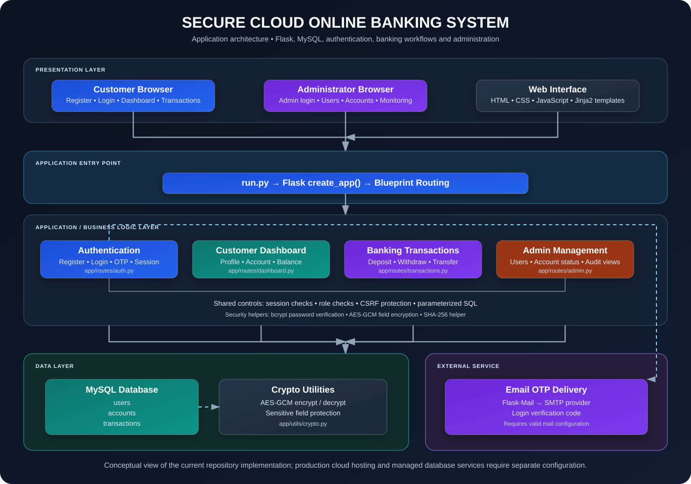

# Secure Cloud Online Banking System

The Secure Cloud Online Banking System is a Flask-based web application that demonstrates core digital banking workflows with a MySQL database and security-focused application components. Users can register, authenticate through password and email OTP verification, view account information, and perform banking operations such as deposits, withdrawals, and account-to-account transfers. An administrative area provides user, account, and transaction oversight.

This project is intended for learning and demonstration. It should not be treated as production-ready banking software without a security review, stronger transaction controls, operational hardening, and deployment-specific testing.

## Overview

The Secure Cloud Online Banking System provides a web-based environment for exploring how common banking operations can be organized in a database-backed application. Customers can create an account, sign in with email OTP verification, review account balances and transaction history, and use deposit, withdrawal, and transfer workflows. Administrators have a separate area for reviewing users, managing account status, and monitoring transactions.

The application is built with Python and Flask, uses MySQL for persistent records, and renders its interface with HTML templates, CSS, and JavaScript. Supporting security components include bcrypt-based password hashing, AES-GCM encryption utilities for selected sensitive fields, and Flask-WTF CSRF protection. These are educational implementations and do not by themselves make the application suitable for production banking.

The repository also includes database setup and schema-update utilities to help prepare the local development environment. Configuration and database scripts should be reviewed before use, and credentials must be supplied securely rather than stored in source code.

<!-- Project screenshots: add these JPEG files to the repository's images/ directory.
     The width attributes control how large the images appear on GitHub. -->

<p align="center">
  
</p>

<p align="center">
  
</p>

<p align="center">
  
</p>

<p align="center">
  
</p>

## Problem Statement

Online banking applications handle sensitive personal and financial information. A banking application must protect account data, verify user access, preserve transaction records, and provide appropriate oversight of accounts and transactions.

This project explores these requirements through a web application that combines authentication, database-backed banking workflows, data encryption utilities, password hashing, CSRF protection, and an administrative dashboard.

## Key Features

### User Authentication and Accounts

- User registration with a profile and automatically created account.
- Login using an email address and password.
- Email-based one-time password (OTP) verification with a five-minute validity period.
- Session-based login and logout.
- Account status checks in relevant authentication flows.
- Profile and account information pages.

### Banking Operations

- Account balance and summary dashboard.
- Deposit and withdrawal workflows.
- Transfers to another account using the recipient's email address or account number.
- Transaction list and transaction history.
- Transaction descriptions, timestamps, and status records.
- SHA-256 transaction digest generation in transaction workflows.

### Administrative Functions

- Separate administrator login flow with role checking.
- Overview of registered users, accounts, balances, deposits, and transactions.
- User listing and user deletion.
- Account listing and account status management, including suspend, activate, and close actions.
- Transaction monitoring with search and type/status filters.
- Visibility of high-value transactions for review.

### Security Components

- Bcrypt password hashing, combined with a SHA-256 preprocessing step in the current authentication implementation.
- AES-GCM encryption and decryption utilities for sensitive values such as phone numbers and account numbers.
- Flask-WTF CSRF protection initialized for the application.
- Parameterized SQL queries in application database operations.
- Session-based access checks for user and administrator pages.

These features describe the current code, not a claim of a completed security audit. A SHA-256 transaction digest alone is not a complete tamper-proof audit system, and the application requires further review before handling real money or personal information.

## Technologies Used

| Component | Technology | Purpose |
|---|---|---|
| Language | Python | Application logic |
| Web framework | Flask 3.1.x | Routing, sessions, and application setup |
| Database | MySQL | Users, accounts, and transaction records |
| Database integration | Flask-MySQLdb / mysqlclient | MySQL connectivity |
| Templates | Jinja2, HTML, CSS, JavaScript | Server-rendered interface |
| Password security | bcrypt and SHA-256 preprocessing | Password verification |
| Data encryption | AES-GCM via Python cryptography package | Encrypting selected sensitive fields |
| Form protection | Flask-WTF CSRFProtect | CSRF token validation |
| Configuration | python-dotenv | Loading local environment configuration |
| Email verification | Flask-Mail with Gmail SMTP configuration | Sending login OTPs |

Dependency versions are defined in `requirements.txt`. The repository currently uses MySQL on localhost in its application configuration; AWS deployment components mentioned in earlier project descriptions should be configured and verified separately before use.

## System Architecture

The architecture below shows how customer and administrator requests move through the Flask application, its route blueprints, shared security helpers, MySQL data layer, and email OTP service.

<p align="center">
  
</p>

### Architecture Components

- **Presentation layer:** Browser-based customer and administrator interfaces rendered with HTML, CSS, JavaScript, and Jinja2 templates.
- **Application entry point:** `run.py` starts the Flask application, and `create_app()` configures the application and registers its route blueprints.
- **Authentication:** Registration, password verification, email OTP verification, and session creation are handled in `app/routes/auth.py`.
- **Customer dashboard:** Account details, profile information, balance summaries, and recent activity are handled in `app/routes/dashboard.py`.
- **Transaction processing:** Deposit, withdrawal, transfer, and transaction-history workflows are handled in `app/routes/transactions.py`.
- **Administration:** Role-checked administrator views support user management, account status management, and transaction monitoring in `app/routes/admin.py`.
- **Data layer:** MySQL stores user, account, and transaction records.
- **Security utilities:** `app/utils/crypto.py` provides AES-GCM encryption/decryption helpers and a SHA-256 helper. Bcrypt is used for password-hash verification, and Flask-WTF initializes CSRF protection.
- **Email service:** Flask-Mail sends login OTPs through the configured SMTP provider.

### How the System Works

1. A customer or administrator opens the web application in a browser.
2. Flask routes the request to the appropriate authentication, dashboard, transaction, or admin blueprint.
3. Login checks the submitted credentials. For customer login, the application sends an email OTP and verifies it before completing the session.
4. Authorized requests read or update the relevant MySQL records.
5. Sensitive fields that use the crypto utility are encrypted or decrypted by the application as required.
6. The application returns rendered pages showing account details, transaction results, or administrator monitoring information.

**Deployment note:** This diagram documents the repository's current Flask/MySQL application flow. It does not imply that AWS EC2, Amazon RDS, a load balancer, or other cloud infrastructure is already configured in the code. Those deployment components must be provisioned and configured separately.
## Project Structure

```text
Secure-Cloud-Online-Banking-System/
|
|-- Secure-Cloud-Banking-System/
|   |-- app/
|   |   |-- __init__.py              # Flask application factory and configuration
|   |   |-- routes/
|   |   |   |-- auth.py              # Registration, login, OTP, logout
|   |   |   |-- dashboard.py         # Dashboard, accounts, profile
|   |   |   |-- transactions.py      # Deposits, withdrawals, transfers, history
|   |   |   |-- admin.py             # Administrative login and management
|   |   |
|   |   |-- utils/
|   |   |   |-- crypto.py            # AES-GCM and SHA-256 helpers
|   |   |
|   |   |-- templates/               # Jinja2 HTML templates
|   |   |-- static/                  # CSS, JavaScript, and static assets
|   |
|   |-- db_update.py                 # Database schema update script
|   |-- run.py                       # Application entry point
|
|-- setup_database.py                # Initial database/table setup
|-- dump_schema.py                   # Database schema utility
|-- verify_crypto.py                 # Local verification script
|-- requirements.txt                 # Python dependencies
|-- README.md
```

## Database Overview

The application uses MySQL to store banking data.

### Users

Stores user identity and authentication fields, including name, email, phone, password hash, role/status fields, and timestamps where present in the active schema.

### Accounts

Associates a banking account with a user and stores account number, balance, currency/type, account status, and creation timestamp.

### Transactions

Stores activity such as deposits, withdrawals, and transfers, including amount, description, status, timestamp, and additional transaction metadata used by the application's transaction and admin views.

The repository includes both an initial database setup script and a later schema update script. Make sure the database schema matches the fields used by the current application modules before running the application on a fresh database.

## Getting Started

### Prerequisites

Install the following before setup:

- Python 3.10 or later.
- MySQL Server.
- Git.
- A Gmail account configured for SMTP with an app password, if testing email OTP.
- A C compiler and MySQL client development libraries if `mysqlclient` requires building from source on your operating system.

### 1. Clone the Repository

```bash
git clone https://github.com/ayusjakhmola25/Secure-Cloud-Online-Banking-System.git
cd Secure-Cloud-Online-Banking-System
```

### 2. Create and Activate a Virtual Environment

Windows:

```powershell
python -m venv .venv
.venv\Scripts\Activate.ps1
```

Linux or macOS:

```bash
python3 -m venv .venv
source .venv/bin/activate
```

### 3. Install Dependencies

```bash
python -m pip install --upgrade pip
pip install -r requirements.txt
```

### 4. Configure Local Environment

Before starting the application, review and update the configuration in `Secure-Cloud-Banking-System/app/__init__.py` and the environment loading path.

The current code has database and SMTP settings hard-coded in the Flask application factory, while the encryption key is read from environment configuration. For a local setup, move all secrets to environment variables and update the code to read them consistently. Do not commit real credentials or encryption keys.

Example values to configure locally (replace every placeholder):

```env
SECRET_KEY=replace-with-a-long-random-secret
ENCRYPTION_KEY=replace-with-a-valid-base64-encoded-32-byte-key
MYSQL_HOST=localhost
MYSQL_USER=your_mysql_username
MYSQL_PASSWORD=your_mysql_password
MYSQL_DB=securebank
MAIL_USERNAME=your_email@example.com
MAIL_PASSWORD=your_email_app_password
```

These are example variable names; the current application factory must be updated to read the database and mail values from the environment rather than hard-coded values.

Generate a Flask secret key:

```bash
python -c "import secrets; print(secrets.token_hex(32))"
```

Generate an AES-GCM key in URL-safe Base64 format:

```bash
python -c "import base64, os; print(base64.urlsafe_b64encode(os.urandom(32)).decode())"
```

### 5. Prepare the Database

Make sure the MySQL service is running and that the configured database user has permission to create the database and tables.

The repository provides a setup script:

```bash
python setup_database.py
```

Review `setup_database.py` and `Secure-Cloud-Banking-System/db_update.py` before running them. The setup script in the current repository contains hard-coded local database credentials and sample administrator data; replace those values with your own local configuration first. Confirm that the resulting schema contains all columns referenced by the active application modules.

### 6. Run the Application

```bash
cd Secure-Cloud-Banking-System
python run.py
```

The current entry point binds to `127.0.0.1:5000`. Open the following URL in your browser:

```text
http://127.0.0.1:5000
```

The root route redirects to the login page. Email OTP delivery requires valid SMTP configuration.

## Main Application Routes

The following routes are registered in the current code. Some routes accept both GET and POST requests.

| Route | Purpose |
|---|---|
| `/` | Redirects to the login page |
| `/auth/register` | User registration |
| `/auth/login` | User login |
| `/auth/verify-otp` | Email OTP verification |
| `/auth/logout` | End the current session |
| `/dashboard` | User dashboard |
| `/accounts` | Account details |
| `/profile` | View or update profile |
| `/deposit` | Deposit workflow |
| `/deposit/confirm` | Confirm a deposit |
| `/withdraw` | Withdrawal workflow |
| `/withdraw/confirm` | Confirm a withdrawal |
| `/transfer` | Transfer to another account |
| `/transactions` | Transaction list |
| `/history` | Transaction history |
| `/admin/login` | Administrator login |
| `/admin/dashboard` | Administrative overview |
| `/admin/users` | User management |
| `/admin/accounts` | Account management |
| `/admin/transactions` | Transaction monitoring |

Administrative mutation endpoints include actions for deleting users and suspending, activating, or closing accounts. Access is intended to be restricted to administrator sessions.

## Security Notes and Limitations

This repository is an educational project and should be hardened before deployment:

- **Rotate exposed credentials immediately.** The current repository contains hard-coded database and SMTP credentials and a committed encryption key. Treat exposed values as compromised, revoke or rotate them, and remove them from source control history where appropriate.
- **Do not commit secrets.** Add `.env`, virtual environments, cache directories, and local database exports to `.gitignore`. Commit a `.env.example` containing placeholders only.
- **Use a stable secret key.** Avoid generating a new Flask `SECRET_KEY` on each startup because it invalidates sessions and CSRF tokens.
- **Harden transaction operations.** Add server-side validation for numeric amounts, positive values, sufficient balance, and transaction limits; use atomic database transactions and appropriate locking to prevent race conditions.
- **Review OTP handling.** Use a cryptographically secure random generator, avoid storing raw OTP values in a client-side session, apply rate limits, and avoid exposing internal exception messages to users.
- **Review session and cookie settings.** Enable secure cookie attributes and HTTPS in deployed environments.
- **Validate authorization.** Test every user and admin route for access control and ensure that one user cannot access another user's account or transactions.
- **Verify encryption behavior.** Ensure that keys are managed outside source control, backup/rotation procedures exist, and decryption failures do not silently conceal data corruption.
- **Do not describe transaction hashes as tamper-proof by themselves.** A plain SHA-256 digest stored beside a transaction is not a complete integrity or audit mechanism.
- **Test the database schema and workflows.** The setup and schema update scripts may need alignment with the current route implementations.

Do not use this application with real financial accounts or sensitive customer data until it has undergone professional security testing and deployment hardening.

## Learning Outcomes

This project demonstrates practical work with:

- Flask application structure and Blueprints.
- MySQL schema design and relational data access.
- Session-based authentication and role checks.
- Email OTP login flows.
- Password hashing and authenticated encryption concepts.
- CSRF protection and form handling.
- Banking workflow modeling and transaction history.
- Administrative monitoring interfaces.
- Configuration and deployment security considerations.

## Future Improvements

- Move every credential and connection setting to environment-based configuration.
- Add automated unit and integration tests for authentication and money movement.
- Strengthen transaction atomicity, concurrency handling, and audit logging.
- Add rate limiting and security-event logging.
- Improve schema migration management.
- Add containerized development and deployment support.
- Use HTTPS and production-grade server configuration.
- Introduce continuous integration and dependency/security scanning.

## License

Review the repository's license file and ownership requirements before redistributing or deploying this project.
